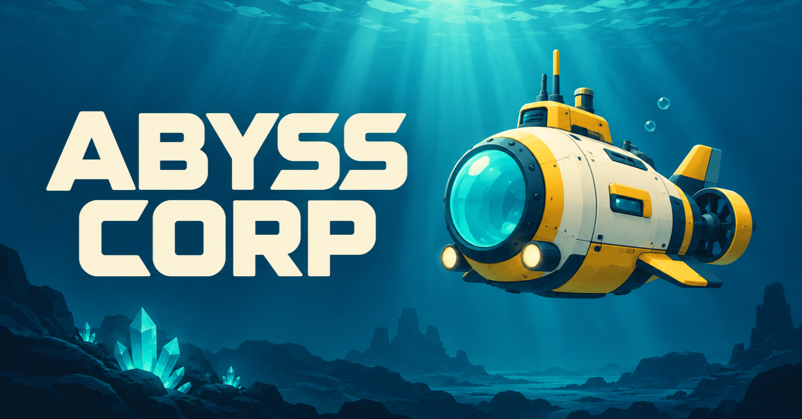
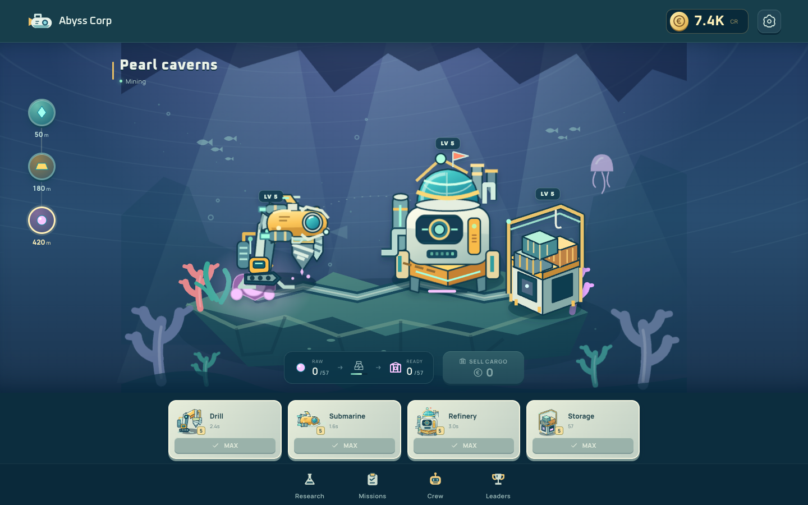

[](https://abysscorp.us.ci/)

<div align="center">

**[Play](https://abysscorp.us.ci/) · [Release](https://github.com/neprostostas/abyss-corp/releases/tag/v0.1.0) · [Docker](https://github.com/neprostostas/abyss-corp/pkgs/container/abyss-corp)**

Build your underwater empire. Mine crystals, automate your outposts, and explore the abyss.

</div>



### Start small. Go deeper.

- **Build a living base.** Watch your drill, submarine, refinery, and warehouse work together.
- **Explore three depths.** Mine bright crystals, uncover gold, and collect deep-sea pearls.
- **Put your crew to work.** Hire cargo pilots and keep earning while you are away.
- **Reach the abyss beacon.** Complete research, grow your outposts, and supply three expeditions.

Your progress follows your account. Play on your phone or settle in on a bigger screen.

### Local checks

```sh
npm ci
npm run check
npm run build
```

`check` includes TypeScript, lint, formatting and deterministic regression tests. Use `npm test` to run only tests or `npm run test:watch` during a fix. Tests use local fixtures and never contact player accounts or send email.
